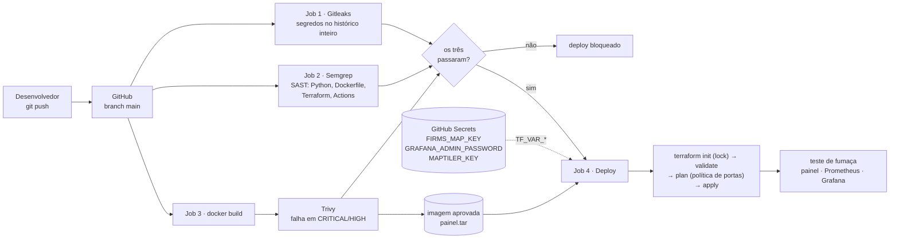
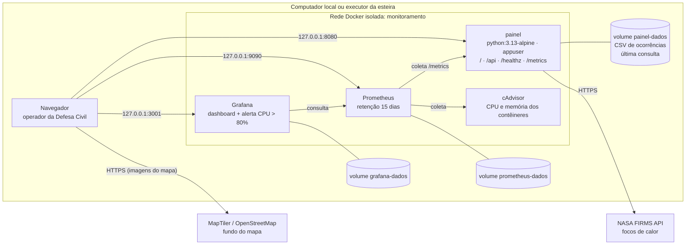

# Merlin

Assistente pessoal por voz para Windows, **100% local**: ouve, entende e responde em voz alta e executa tarefas no computador (abrir e fechar programas, pesquisar na internet, clicar em botões). Nada do que você fala sai do seu PC.

Vem com um assistente pronto, o **Merlin** (um mordomo digital, com uma esfera 3D), e você pode criar outros pela própria interface.

O projeto também tem um **painel de alertas de focos de calor** (dados da NASA FIRMS para a Defesa Civil), que roda em contêiner com esteira DevSecOps, infraestrutura como código e observabilidade.

**Índice**

| Parte | Seções |
|---|---|
| **Merlin (assistente por voz no Windows)** | [O que ele faz](#o-que-ele-faz) · [Requisitos](#requisitos) · [Instalação](#instalação) · [Como usar](#como-usar) · [Como funciona](#como-funciona) · [Privacidade](#privacidade) · [Desenvolvimento](#desenvolvimento) · [Problemas comuns](#problemas-comuns) |
| **Infraestrutura, DevSecOps e Observabilidade** | [Visão geral](#infraestrutura-devsecops-e-observabilidade) · [1. Diagrama da arquitetura](#1-diagrama-da-arquitetura) · [2. Matriz de responsabilidade compartilhada](#2-matriz-de-responsabilidade-compartilhada) · [3. Mapeamento LGPD](#3-mapeamento-lgpd) · [4. Estimativa de custo](#4-estimativa-de-custo) · [5. Guia de reprodução](#5-guia-de-reprodução) |

---

## O que ele faz

- **Ativação por voz:** diga o nome do assistente ("Merlin, abre o chrome").
- **Modo discreto:** um pedido rápido junto com o nome ("Merlin, abre o spotify") é resolvido sem abrir o cartão: a resposta aparece num balão ao lado da bolinha e ele volta a esperar. Conversas, perguntas de confirmação, erros e respostas longas abrem o cartão.
- **Tarefas no computador:** abrir e fechar programas, pesquisar na internet, clicar em botões de qualquer janela ("dá play", "salva", "clica em cancelar no word"). Antes de clicar em algo perigoso (excluir, pagar, enviar), ele pergunta.
- **Várias tarefas numa frase:** "abre o chrome e fecha o telegram" vira uma resposta só ("Abri o chrome e fechei o telegram").
- **Conversa:** responde perguntas no jeito da personalidade e lembra o que foi dito na conversa atual.
- **Interrupção:** fale por cima e ele para de falar.
- **Janelas:**
  - **Bolinha (em espera):** fica no canto da tela com o nome do assistente. O anel mostra o estado: cor do assistente normalmente, vermelho com o microfone no mudo, laranja piscando se a IA (Ollama) não responde. Com o mouse por perto, aparecem os botões de configurações, microfone e modo debug (que mostra no cartão uma aba com o raciocínio da IA: o que ela entendeu e decidiu em cada pedido).
  - **Cartão (ativo):** a bolinha cresce para cima e vira um cartão no canto direito, sem cobrir o programa em uso. A resposta aparece junto com a voz, palavra por palavra.
  - **Central:** uma janela só, com abas.
    - *Pastas:* apelidos para as suas pastas ("abre o trabalho"), além das do Acesso Rápido do Windows.
    - *Ajustes:* assistente e voz, modelo de IA.
    - *Ferramentas:* editor de assistentes (cria e edita personalidades sem mexer em código) e skills (tudo o que ele sabe fazer, com um teste de frases; título, descrição e exemplos podem ser editados).
    - Embaixo, o status do sistema ao vivo.

---

## Requisitos

| Item | Observação |
|---|---|
| **Windows 10 ou 11** | Usa recursos do Windows (janelas, botões, o navegador interno WebView2). Não roda em Linux nem macOS. |
| **Python 3.13** | De [python.org](https://www.python.org/downloads/). |
| **Ollama** | O programa que roda a IA localmente: [ollama.com](https://ollama.com/download). |
| **Microfone** | Qualquer um. |
| **Placa de vídeo NVIDIA** (recomendada, com o driver atualizado) | O reconhecimento de voz e a IA ficam mais rápidos nela. Sem placa NVIDIA, tudo roda no processador, com um modelo de voz menor e respostas mais lentas. |
| **WebView2 Runtime** | Já vem no Windows 11 e com o Edge. No Windows 10, se a janela não abrir, instale-o pelo site da Microsoft. |

**Espaço em disco:** ~6 GB na instalação básica.

---

## O que vem no repositório e o que você baixa

### Já está no repositório

| O quê | Onde |
|---|---|
| Código do assistente | `main.py`, `merlin/` |
| Páginas das janelas, sons de ativação, olho e esfera | `recursos/` |
| O assistente original, Merlin (não pode ser excluído; "Restaurar original" volta para ele) | `recursos/assistentes_padrao/*.json` |
| **Vozes do Piper** em português (Faber, Cadu, Jeff; ~63 MB cada) | `vozes/*.onnx` |
| Ferramentas (baixar modelos, avaliar a IA, gerar sons) | `ferramentas/` |
| Testes automáticos | `tests/` |
| Ajustes dos assistentes originais | `assistentes_citizentech/*.json` |
| Ajustes das habilidades | `skills/*.json` |
| Amostras de áudio usadas para comparar as vozes do mago (não são necessárias para rodar) | `amostras_mago/` |

### Você baixa de fora

| O quê | Tamanho | Como |
|---|---|---|
| Python 3.13 | – | instalador do python.org |
| Bibliotecas Python | ~2,5 GB | `pip install -r requirements.txt` |
| Ollama + um modelo de IA | ~5 GB | instalador do Ollama + `ollama pull` |
| Modelos de reconhecimento de voz (Whisper) | ~2,1 GB | `ferramentas\baixar_modelos.py` → pasta `modelos/` |

### Criado no seu PC durante o uso (fora do git)

| Pasta | Conteúdo |
|---|---|
| `.venv/` | o ambiente Python com as bibliotecas |
| `modelos/` | modelos do Whisper |
| `registros/` | o raciocínio da IA, um arquivo por dia, apagado após 30 dias |
| `merlin_config.json` | suas preferências (assistente, voz, modelo e apelidos de pastas) |

---

## Instalação

Num terminal (PowerShell), na pasta do projeto:

```powershell
# 1. Ambiente Python e bibliotecas
py -3.13 -m venv .venv
.venv\Scripts\python.exe -m pip install -r requirements.txt

# 2. Modelos de reconhecimento de voz (~2,1 GB, vão para modelos\)
.venv\Scripts\python.exe ferramentas\baixar_modelos.py

# 3. IA local: instale o Ollama (ollama.com) e baixe o modelo padrão
ollama pull qwen3:8b
```

O modelo padrão é o `qwen3:8b`. Deixe o Ollama aberto enquanto usa o assistente.

### Se o modelo ficar lento no seu PC

Baixe outro modelo com `ollama pull` e selecione-o em **Central → Inteligência**. Sem essa escolha, o assistente continua procurando o `qwen3:8b`.

| Sua máquina | Modelo | Observação |
|---|---|---|
| Placa com 8 GB ou mais | `qwen3:8b` | O padrão e o mais testado |
| Placa com cerca de 6 GB | `qwen2.5:7b` | Bom para entender pedidos |
| Placa fraca ou só processador | `qwen3:4b` | Menor e mais rápido; não foi testado |
| Muito limitada | `llama3.2` | O mais leve; deve errar mais |

Quanto menor o modelo, maior a chance de errar ao entender pedidos. As memórias indicadas são aproximadas.

---

## Como usar

```powershell
.venv\Scripts\python.exe main.py
```

Ao abrir, ele calibra o microfone (2 s), carrega os modelos e fica em espera: uma bolinha no canto da tela.

| Diga | O que acontece |
|---|---|
| "**Merlin**" (ou o nome do assistente escolhido) | ativa e cumprimenta |
| "Merlin, abre o spotify" | ativa e abre o programa |
| "fecha o chrome e pesquisa receita de bolo" | faz as duas tarefas |
| "dá play" / "clica em salvar no word" | clica no botão |
| "qual a capital da França?" | responde |
| "abre as suas configurações" | abre a Central |
| "valeu, pode ir" / "pode desligar" | volta para a espera (a bolinha) |

**Outros comportamentos:**
- **Inatividade:** depois de 30 s parado, ele volta sozinho para a espera.
- **Clique:** clicar na bolinha também o ativa.
- **Botões:** na bolinha, passe o mouse para ver os botões. No cartão, ficam no alto: recolher, microfone e Central.

---

## Como funciona

```
microfone
  → detector de voz (Silero)          percebe quando alguém fala e quando parou
  → Whisper (placa de vídeo)          transcreve a frase
  → tem o nome do assistente?         se não tiver e ele estiver em espera, a frase é descartada
  → IA (Ollama): divide as tarefas    "abre o chrome e fecha o telegram" → duas tarefas
  → IA (Ollama): entende cada uma     qual habilidade e qual alvo; regras do código corrigem a IA
  → habilidades executam              abrir programa, clicar, pesquisar, conversar...
  → resposta única                    "Abri o chrome e fechei o telegram"
  → voz (Piper)                       toca enquanto o texto aparece na janela
```

### Estrutura do código

| Pasta | Responsabilidade |
|---|---|
| `merlin/audio/` | microfone, detector de voz, segmentação das frases, transcrição (Whisper) |
| `merlin/ia/` | conversa com o Ollama: intenções, divisão de tarefas, confirmações, conversa, sugestão de assistentes |
| `merlin/habilidades/` | **uma habilidade por arquivo**: descrição e exemplos para a IA, regras, e qual ação executar |
| `merlin/acoes/` | o que é feito no Windows: janelas, botões, programas, navegador |
| `merlin/personalidades/` | carrega os assistentes (todos em .json): os originais de `recursos/assistentes_padrao/` e os da pasta `assistentes_citizentech/` |
| `merlin/voz/` | síntese (Piper), efeitos, reprodução e interrupção |
| `merlin/nucleo/` | o fluxo de cada pedido, sessão, memória da conversa, raciocínio |
| `merlin/interface/` | janelas: a principal (bolinha e cartão) e a Central (ajustes, editor, habilidades) |
| `merlin/config.py` | ajustes técnicos (tempos, limites, caminhos) |
| `main.py` | monta as peças e liga umas nas outras |

### Personalizar

- **Assistentes:** pela aba **Editor** da Central. Lá você define nome, palavras de chamada, voz, aparência, quem ele é, como ele fala, frases prontas e expressões típicas. A IA local pode sugerir o resto a partir de "Quem ele é". Todos os assistentes são arquivos .json no mesmo formato: o original (Merlin) em `recursos/assistentes_padrao/`, e os seus e os ajustes do original em `assistentes_citizentech/`.
- **Habilidades:** crie um arquivo em `merlin/habilidades/` (veja um vizinho como modelo) e a ação em `merlin/acoes/`. Ela entra sozinha no que a IA lê e nas ações, e aparece na aba Skills da Central, onde você pode ajustar o título, a descrição e os exemplos (ficam em `skills/*.json`).
- **Ajustes técnicos:** em `merlin/config.py`, por exemplo a pausa que encerra uma frase (`PAUSA_FIM_FRASE`) e o tempo de inatividade (`TEMPO_INATIVIDADE`).

---

## Privacidade

- **Tudo roda no seu PC:** reconhecimento de voz, IA e síntese de voz. O assistente só usa a internet para **baixar** modelos e bibliotecas e para o que você pedir, como pesquisar ou abrir um site.
- **Em espera, o microfone fica aberto:** ele transcreve o que é falado perto apenas para procurar o nome do assistente, e o que não tem o nome é descartado.
- **O que fica salvo no disco:**
  - `registros/`: o raciocínio de cada pedido, apagado após 30 dias;
  - `merlin_config.json` e `assistentes_citizentech/`: as suas preferências.

---

## Desenvolvimento

```powershell
# Testes automáticos (não usam microfone nem a IA)
.venv\Scripts\python.exe -m unittest discover -s tests -t .

# Precisão da IA ao entender pedidos (usa o Ollama de verdade)
.venv\Scripts\python.exe ferramentas\avaliar_classificador.py qwen3:8b
```

Ao criar uma habilidade, acrescente frases dela em `ferramentas/frases_avaliacao.py` e rode a avaliação antes e depois.

---

## Problemas comuns

| Sintoma | O que verificar |
|---|---|
| "Não consegui falar com o meu cérebro" | O Ollama está aberto? O modelo escolhido foi baixado (`ollama list`)? |
| A janela não abre | WebView2 Runtime instalado? |
| Reconhecimento lento | Sem placa NVIDIA, ele usa o modelo `small` no processador. Confira se `modelos\large-v3-turbo` existe. |
| Não reage ao nome | O anel da bolinha está vermelho? É o mudo: passe o mouse e clique no microfone. Senão, fale o nome do assistente escolhido na Central e veja as palavras de chamada no Editor. |
| Aviso de `flash-attn` ou `torchaudio` no terminal | Inofensivo. |

---
---

# Infraestrutura, DevSecOps e Observabilidade

O Merlin é um app de desktop para Windows (janela, microfone, voz, automação do sistema) e não roda em contêiner. O que vai para a infraestrutura é o **painel de alertas de focos de calor**: a mesma página da aba Alertas da Central (`recursos/alertas.html`), servida por HTTP, com o robô **FIRMS Monitor** consultando a NASA na busca automática. O painel mostra os focos de calor e as áreas dos incêndios no mapa, com o risco de cada um.

| Módulo | O que foi feito | Arquivos |
|---|---|---|
| **1. Contêiner** | Imagem multi-stage em `python:3.13-alpine` (77 MB), usuário sem privilégios, sem segredos, sem pip; `docker compose up` sobe o painel e a observabilidade | [Dockerfile](Dockerfile), [.dockerignore](.dockerignore), [docker-compose.yml](docker-compose.yml), [.env.example](.env.example), [merlin/web/](merlin/web/) |
| **2. IaC** | Terraform com o provider Docker: a mesma pilha, com portas só em loopback e bloqueio de portas de administração | [terraform/](terraform/) |
| **3. Esteira** | GitHub Actions: Gitleaks, Semgrep e Trivy em paralelo; deploy por Terraform só se os três passarem | [.github/workflows/devsecops.yml](.github/workflows/devsecops.yml), [scripts/demo_gitleaks_falha.sh](scripts/demo_gitleaks_falha.sh) |
| **4. Observabilidade** | Prometheus, Grafana e cAdvisor; dashboard das 4 métricas de ouro; alerta de CPU acima de 80% | [observability/](observability/), [merlin/web/metricas.py](merlin/web/metricas.py) |

## 1. Diagrama da arquitetura

### Esteira CI/CD (a cada push na `main`)



Num pull request para a `main`, rodam as três verificações, sem deploy. As GitHub Actions são fixadas pelo hash do commit, e o token da esteira só tem permissão de leitura.

### Infraestrutura (docker compose ou Terraform)



- **Portas:** só em `127.0.0.1`; nada fica aberto para a rede. O cAdvisor nem é publicado. Nenhuma porta de administração (SSH 22, RDP 3389, Docker 2375/2376, WinRM 5985/5986, VNC 5900, Telnet 23) pode ser publicada: o Terraform recusa no `plan`.
- **Contêineres:** sistema de arquivos só leitura (painel), `cap_drop: ALL`, `no-new-privileges`, limites de CPU e memória, logs com rotação (3 × 10 MB).
- **Painel sem login:** abre no perfil **operador** (só vê). O perfil administrador, que muda a busca automática, é ligado por variável de ambiente. A API aceita só uma lista fixa de funções e um cabeçalho próprio, o que barra chamadas vindas de outros sites. As respostas trazem CSP, `X-Frame-Options: DENY` e `nosniff`.

### Observabilidade: as 4 métricas de ouro

| Métrica | De onde vem | Consulta (PromQL) |
|---|---|---|
| **Latência** | painel, `/metrics` (histograma) | `histogram_quantile(0.95, sum by (le) (rate(painel_http_request_duration_seconds_bucket[5m])))` |
| **Tráfego** | painel, `/metrics` | `sum(rate(painel_http_requests_total[5m]))` |
| **Erros** | painel, `/metrics` | taxa de respostas 4xx/5xx e `painel_alertas_buscas_total{resultado="erro"}` (falhas na NASA) |
| **Saturação** | cAdvisor | `rate(container_cpu_usage_seconds_total[1m])` e `container_memory_working_set_bytes / container_spec_memory_limit_bytes` |

O dashboard **"Merlin CitizenTech · Métricas de Ouro"** e a regra **"CPU acima de 80%"** sobem sozinhos com o Grafana (provisionamento em [observability/grafana/provisioning/](observability/grafana/provisioning/)). A regra exportada pelo próprio Grafana está em [observability/grafana/exportado/](observability/grafana/exportado/alerta-cpu-acima-de-80.yaml).

## 2. Matriz de responsabilidade compartilhada

Hoje a infraestrutura é local (Docker no computador da Defesa Civil, ou no executor do GitHub Actions). A última coluna mostra como a divisão muda se ela for para a nuvem (AWS EC2, por exemplo).

| Camada | Provedor | Nós (código e equipe) | Na nuvem (EC2) |
|---|---|---|---|
| **Hardware, rede física, energia** | Dono do computador / Microsoft (executores do GitHub) | – | AWS |
| **Sistema operacional do host** | Microsoft (Windows) / GitHub (Ubuntu dos executores) | Manter o Windows e o Docker Desktop atualizados | **Nós** (atualizações do Linux da EC2) |
| **Motor de contêiner** | Docker (Docker Desktop / Engine) | Configuração: rede isolada, portas em loopback | Nós |
| **Imagens base** (`python:3.13-alpine`, Prometheus, Grafana, cAdvisor) | Mantenedores das imagens oficiais | Fixar versões, `apk upgrade`, scan com Trivy a cada push | Nós |
| **Imagem do painel** | – | Multi-stage, `appuser`, sem pip, sem segredos, só leitura | Nós |
| **Código da aplicação** | – | SAST (Semgrep), testes, cabeçalhos de segurança, validação de entradas | Nós |
| **Dependências Python** | Mantenedores dos pacotes (PyPI) | Versões fixas em `requirements-painel.txt`; Trivy acusa vulnerabilidades | Nós |
| **Segredos** | GitHub (cofre dos Secrets, mascarados nos logs) | Nunca no Git ou na imagem (Gitleaks barra); `.env` e `*.tfvars` no `.gitignore`; trocar as chaves se vazarem | AWS Secrets Manager (opcional) |
| **Infraestrutura como código** | HashiCorp (Terraform) e o provider Docker | Política de portas, lock do provider com hash, estado fora do Git | Nós + *security groups* da AWS |
| **Esteira CI/CD** | GitHub (executores, isolamento entre execuções) | Actions fixadas por hash, token só leitura, deploy só da `main` | Igual |
| **Dados de focos de calor** | NASA FIRMS (disponibilidade e qualidade) | Tratar falhas da API (contadas na métrica de erros), não depender de um único dado | Igual |
| **Mapa** | MapTiler / OpenStreetMap | Conferir a chave antes de usar; cair para o OpenStreetMap se ela falhar | Igual |
| **Monitoramento e alertas** | Grafana Labs, Prometheus (software) | Dashboard, regra de alerta, atender o alerta | Igual |
| **Acesso de pessoas** | – | Senha forte do Grafana (12+ caracteres), painel no perfil operador, portas só locais | IAM da AWS + VPN |

## 3. Mapeamento LGPD

**Resumo:** o painel de alertas **não trata dados pessoais de cidadãos**. Os focos de calor são coordenadas de pixels de satélite, dados públicos da NASA, e não identificam pessoas. Os dados pessoais do projeto estão no **Merlin desktop** (voz e preferências de quem o usa), que fica só no computador, e na **conta de administrador do Grafana**.

### Onde cada dado fica e como é protegido

| Dado | É pessoal? | Onde fica | Proteção | Retenção |
|---|---|---|---|---|
| Focos de calor (latitude, longitude, FRP, satélite, horário) | Não (dado público da NASA) | Volume `painel-dados`: `dados/incendio/ocorrencias.csv` e `dados/alertas/ultima_consulta.json` | Só o usuário `appuser` grava; o resto do contêiner é só leitura; acesso pela porta local | O CSV acumula as ocorrências (histórico para a Defesa Civil); a última consulta é substituída a cada busca |
| Chaves da NASA e do MapTiler, senha do Grafana | Não pessoais, mas **segredos** | `.env` (local) e GitHub Secrets (esteira) | Fora do Git (`.gitignore`) e da imagem (`.dockerignore`); Gitleaks barra commits com chaves; Secrets mascarados nos logs | Até serem trocadas |
| Estado do Terraform | Contém os segredos em texto puro | `terraform/terraform.tfstate` (local) | Fora do Git (`.gitignore`); na esteira, some com o executor | Até o próximo `apply`/`destroy` |
| Conta de administrador do Grafana (usuário, sessões) | **Sim** (identifica quem administra) | Volume `grafana-dados` | Senha forte obrigatória, cadastro de novos usuários desligado, sem acesso anônimo, cookie `SameSite=strict`, porta local | Enquanto o volume existir |
| Métricas (latência, tráfego, CPU) | Não (nenhum IP ou usuário vira rótulo) | Volume `prometheus-dados` | Rede interna do Docker; porta local | 15 dias |
| Logs dos contêineres | Não no nível INFO (o IP de quem acessa só aparece no nível DEBUG) | Docker, `json-file` | Rotação: 3 arquivos de 10 MB por contêiner | Até a rotação |
| **Merlin desktop:** áudio do microfone | **Sim** | Só na memória, transcrito no próprio PC | Nada sai do computador; frases sem o nome do assistente são descartadas | Não é gravado |
| **Merlin desktop:** raciocínio da IA (o que a pessoa pediu) | **Sim** | `registros/` | Fora do Git; só no PC | Apagado após 30 dias |
| **Merlin desktop:** amostras de voz clonada | **Sim, dado biométrico (sensível, art. 5º, II)** | `vozes/clonadas/` | Fora do Git; só no PC; usar só com consentimento expresso de quem tem a voz | Até a pessoa apagar |
| **Merlin desktop:** preferências (caminhos de pastas) | Sim (podem conter nomes) | `merlin_config.json`, `assistentes/rick.json` | Fora do Git; só no PC | Até a pessoa apagar |

### Princípios aplicados

- **Minimização (art. 6º, III):** o painel não coleta nada de quem o acessa (sem login, sem cookies próprios, sem IP nas métricas).
- **Segurança (art. 46):** segredos fora do código, contêineres sem privilégios, portas só locais, esteira que barra vazamentos e vulnerabilidades.
- **Prevenção (art. 6º, VIII):** o Gitleaks impede que uma chave chegue ao repositório, e o Trivy, que uma vulnerabilidade conhecida chegue à produção.
- **Base legal:** os focos de calor apoiam a execução de políticas públicas pela Defesa Civil (art. 7º, III, e art. 23). As amostras de voz clonada exigem consentimento específico e destacado (art. 11, I). *A validação jurídica fica com o encarregado de dados (DPO) do órgão.*
- **Direitos do titular (art. 18):** para apagar os dados do Merlin desktop, basta apagar `registros/`, `vozes/clonadas/` e `merlin_config.json`. Para a conta do Grafana, Administration → Users.
- **Se uma chave vazar:** trocá-la na NASA, no MapTiler ou no Grafana, atualizar o `.env` e os GitHub Secrets, e reescrever o histórico se ela chegou a ser commitada.

## 4. Estimativa de custo

Valores mensais de referência, sem impostos. Os preços de nuvem mudam: confira na [AWS Pricing Calculator](https://calculator.aws/) antes de decidir.

### Como está hoje (local + GitHub)

| Item | Uso | Custo mensal |
|---|---|---|
| Computador da Defesa Civil (Docker Desktop) | Painel + Prometheus + Grafana + cAdvisor: ~0,8% de CPU e ~160 MB de RAM no total | **R$ 0** (o computador já existe; o consumo extra de energia é desprezível) |
| GitHub (repositório privado, plano Free) | Inclui 2.000 minutos/mês de Actions. Cada execução da esteira gasta ~5 minutos cobrados (4 jobs: ~1 + 1 + 2 + 1 min) | **R$ 0** até ~400 pushes/mês |
| API NASA FIRMS | Gratuita (limite de 5.000 consultas a cada 10 minutos); a busca automática padrão faz 1 por hora | **R$ 0** |
| MapTiler | Plano gratuito (100 mil pedidos de imagens/mês); sem a chave, OpenStreetMap | **R$ 0** |
| Docker Desktop | Gratuito para uso pessoal, educação e organizações pequenas; acima de 250 funcionários ou US$ 10 milhões de receita anual, exige assinatura (alternativa sem custo: Docker Engine num Linux) | **R$ 0** (no caso do projeto) |
| Prometheus, Grafana OSS, cAdvisor, Terraform, Gitleaks, Semgrep, Trivy | Software livre | **R$ 0** |
| **Total** | | **R$ 0/mês** |

### Se for para a nuvem (AWS, região São Paulo, para os dados ficarem no Brasil)

| Item | Configuração | Custo mensal aproximado |
|---|---|---|
| EC2 `t3.small` (2 vCPU, 2 GB) sob demanda | 730 h/mês em `sa-east-1` | ~US$ 25 |
| Disco EBS gp3 | 30 GB | ~US$ 5 |
| Transferência de dados | Poucos GB/mês (painel + consultas à NASA) | ~US$ 0–1 |
| **Total** | | **~US$ 30/mês (≈ R$ 165)**. Com instância reservada por 1 ano, cai cerca de 40%. |

## 5. Guia de reprodução

### Pré-requisitos

| Ferramenta | Para quê | Instalação no Windows |
|---|---|---|
| Git (com o Git Bash) | Clonar e rodar os scripts | `winget install Git.Git` |
| Docker Desktop | Rodar a pilha | `winget install Docker.DockerDesktop` |
| Terraform 1.6 ou mais novo | Só para o caminho com Terraform | `winget install Hashicorp.Terraform` |
| Chave da API FIRMS (gratuita) | Buscar os focos de calor | [firms.modaps.eosdis.nasa.gov/api/map_key](https://firms.modaps.eosdis.nasa.gov/api/map_key/) |

No Linux ou macOS, os comandos são os mesmos (troque `copy` por `cp`).

### Passo 1: clonar e configurar

```powershell
git clone https://github.com/lucassperanzini/Merlin-CitizenTech.git
cd Merlin-CitizenTech
copy .env.example .env
```

No `.env`, preencha pelo menos:
- `FIRMS_MAP_KEY`: a chave da NASA;
- `GRAFANA_ADMIN_PASSWORD`: uma senha com 12 caracteres ou mais.

O `.env` nunca vai para o Git nem para a imagem.

### Passo 2 (caminho A): subir com o Docker Compose

```powershell
docker compose up -d --build
docker compose ps
```

Em cerca de 1 minuto, todos ficam `Up` e o painel, `healthy`:

| Serviço | Endereço | Acesso |
|---|---|---|
| Painel de alertas | http://127.0.0.1:8080 | sem login (perfil operador) |
| Grafana | http://127.0.0.1:3001 | `admin` e a senha do `.env` |
| Prometheus | http://127.0.0.1:9090 | sem login |

As portas mudam no `.env` (`PAINEL_PORTA_HOST`, `GRAFANA_PORTA_HOST`, `PROMETHEUS_PORTA_HOST`). O Grafana usa a 3001 porque a 3000 costuma estar ocupada (Open WebUI, por exemplo).

Para parar: `docker compose down`. Para apagar também os dados: `docker compose down -v`.

### Passo 2 (caminho B): subir com o Terraform

Use um caminho **ou** o outro: os dois usam as mesmas portas. Antes, `docker compose down`.

```powershell
docker build -t merlin-painel-alertas:local .
cd terraform
copy terraform.tfvars.example terraform.tfvars
terraform init
terraform plan
terraform apply
terraform output
```

No `terraform.tfvars`, preencha `firms_map_key` e `grafana_admin_password`. A linha `docker_host` do modelo já vem para o Windows; no Linux ou macOS, apague-a.

Para desfazer: `terraform destroy`.

### Passo 3: testar

**Testes automáticos do painel** (servidor, métricas e áreas dos incêndios), num Python qualquer, sem instalar nada no computador:

```powershell
docker run --rm -v "${PWD}:/src:ro" -w /src python:3.13-alpine sh -c "pip install -q -r requirements-painel.txt && python -m unittest tests.test_painel_web tests.test_manchas"
```

São 21 testes. A suíte completa (`python -m unittest discover -s tests`) precisa do ambiente do Merlin desktop: veja [Instalação](#instalação).

**Política de portas do Terraform** (cada um destes deve ser recusado):

```powershell
cd terraform
terraform plan -var endereco_publicacao=0.0.0.0
terraform plan -var 'portas={painel=22,prometheus=9090,grafana=3001}'
```

**Métricas de ouro e alerta** (no Git Bash, com a pilha rodando):

```bash
scripts/gerar_trafego.sh 120   # tráfego normal + erros 404/403: enche os gráficos de latência, tráfego e erros
scripts/teste_alerta_cpu.sh    # 1 núcleo ocupado por 3 min: o alerta vai de Normal a Pending e Firing
```

Acompanhe em: Grafana → Dashboards → Merlin CitizenTech → **Métricas de Ouro**, e em Alerting → Alert rules → **CPU acima de 80%**.

**Esteira e demonstração do Gitleaks:**

1. Cadastre os segredos no GitHub, em Settings → Secrets and variables → Actions:
   - `FIRMS_MAP_KEY` (obrigatório);
   - `GRAFANA_ADMIN_PASSWORD` (obrigatório);
   - `MAPTILER_KEY` (opcional).
2. Para pedir aprovação manual antes do deploy: Settings → Environments → `producao` → Required reviewers.
3. Um push na `main` roda a esteira: os 4 jobs devem ficar verdes.
4. Para ver o Gitleaks barrar um vazamento (no Git Bash, com a árvore de trabalho limpa):

   ```bash
   scripts/demo_gitleaks_falha.sh                  # cria uma branch com credenciais FALSAS e mostra o bloqueio
   git push -u origin demo/gitleaks-falha-<data>   # o nome aparece na saída do script
   ```

   Abra um pull request dessa branch para a `main`: o job **1. Secret scanning (Gitleaks)** fica vermelho e o deploy não roda. **Não faça o merge.** Depois, limpe:

   ```bash
   scripts/demo_gitleaks_falha.sh --limpar
   git push origin --delete demo/gitleaks-falha-<data>
   ```
